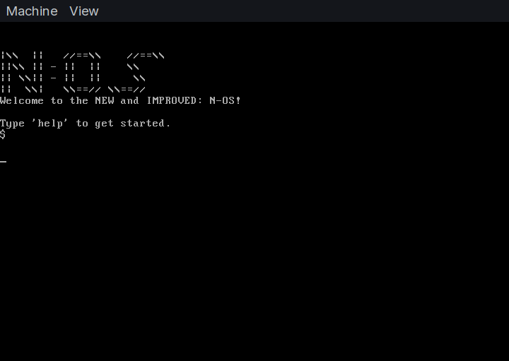

# N-OS
A x86 operating system, utilizing legacy boot!

<center></center>

This was rewritten due to the higher complexity of the [old N-OS](https://github.com/mrgamernavshorts/N-OS-old) project.

> [!NOTE]
> This project is currently in **Alpha**, you are free to post any Issues [here](https://github.com/mrgamernavshorts/N-OS/issues).

# Features
Here is what N-OS currently supports, more will be added later:

* PS/2 Keyboard support.
* Legacy-only BIOS support.
* 32 bit support.
* Interactive shell.
* It's own LIBC(NLIBC).

# Dependencies
These Dependencies are required to compile N-OS:
* gcc
* nasm + ld(Nasm's linker)
* Qemu(Optional, for testing)

# Build instructions
Steps to build N-OS are listed here.

First, clone this repo, and CD into it:
```bash
git clone https://github.com/mrgamernavshorts/N-OS
cd N-OS
```
Then, run `make`:
```bash
make
```
This will build the OS in the `build/` directory, named `nos.img`.

You can also use `make clean` and `make run`:
```bash
make clean # Deletes the build directory
make run # Runs the ISO inside of QEMU
```

> [!NOTE]
> To run `make run`, you must install the `qemu-desktop` package from your package manager.

# License
This project is Licensed under [BSD-3-Clause](https://opensource.org/license/BSD-3-clause).
You can read the license [here](https://github.com/mrgamernavshorts/N-OS/blob/main/LICENSE.md).
